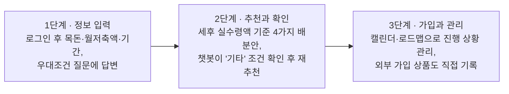
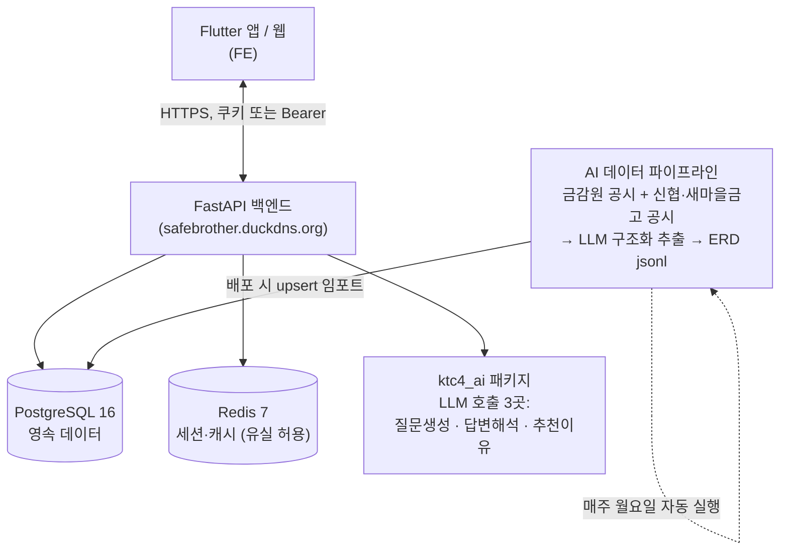

<div align="center">


# 안정형

**내 상황에 맞는 안전 자산 형성을 위한 최적의 자산관리 서비스**

카카오테크 캠퍼스 4기 2단계 팀 프로젝트 · 경북대 4팀

[](frontend)
[](frontend)
[](backend)
[](backend)
[](backend)
[](backend)
[](#)

</div>

---

## 목차

- [소개](#소개)
- [핵심 기능](#핵심-기능)
- [차별화 포인트](#차별화-포인트)
- [서비스 흐름](#서비스-흐름)
- [시스템 아키텍처](#시스템-아키텍처)
- [기술 스택](#기술-스택)
- [리포지토리 구조](#리포지토리-구조)
- [로컬 개발 환경](#로컬-개발-환경)
- [배포](#배포)
- [팀 소개](#팀-소개)
- [문서](#문서)

---

## 소개

신혼부부 김철수 씨는 3년 안에 전세보증금 1억 원을 모으는 게 목표입니다. 목돈 3,000만원과 월 100만원을 저축할 수 있지만, 계좌는 이미 3개 은행 4개 계좌로 흩어져 있고 예·적금·국채에 얼마씩 나눠 넣어야 할지 계산할 방법이 없습니다.

**안정형**은 이런 문제를 풀기 위한 서비스입니다. 목돈·월 저축액·기간과 개인 상황(주거래은행, 비과세 대상 여부, 급여이체·카드 실적 등)을 입력받아, **세후 실수령액 기준**으로 예금·적금 상품을 조합한 최적의 포트폴리오를 제시합니다. 가입 후에는 만기 캘린더와 실시간 진행률로 저축 여정까지 관리해줍니다.

> "내가 놓친 이자, 숫자로 보여드립니다."

## 핵심 기능

| 기능 | 설명 |
|---|---|
| 🔐 **간편 로그인** | 구글·카카오 소셜 로그인 + 로그인 없이도 이용 가능한 게스트 모드 (이후 로그인 시 기록 자동 승계) |
| 📝 **3단계 정보 입력** | 목돈·월 저축액·기간부터 보유 은행, 비과세 대상, 급여이체·카드 실적 등 우대조건까지 |
| 💰 **4종 포트폴리오 추천** | 단순형 · 균형형 · 최대형 · 안정형 — 세후 실수령액 기준으로 계산, 주거래은행 단일 상품과 비교까지 |
| 🤖 **AI 챗봇 조건 확인** | 추천 상품의 '기타' 우대조건 중 자동 판정이 어려운 것만 챗봇이 질문하고, 답을 반영해 재계산 |
| 📅 **만기 캘린더 & 로드맵** | 가입 상품의 납입일·만기일을 캘린더로, 경과 개월과 누적 이자를 로드맵으로 관리 |
| ✍️ **직접 기록** | 다른 곳에서 가입한 상품도 캘린더에 직접 기록해 함께 관리 |

## 차별화 포인트

1. **우대조건 해석의 어려움 → AI가 먼저 읽고, 애매한 것만 사용자에게 질문**
   실제 약관의 복잡한 우대조건(4대연금 수급실적, 요구불예금 평균잔액 등)을 AI가 구조화해서 해석하고, 판정이 애매한 조건만 챗봇이 직접 물어봅니다.
2. **단순 필터링이 아닌 개인 상황 기반 배분안**
   목돈·월저축액·기간·주거래은행·나이·비과세 요건 등을 종합해 단순형/균형형/최대형/안정형 4가지 배분안을 계산해서 제시합니다.
3. **법적 제약(예금자보호 한도) 반영**
   2025.9.1부터 상향된 예금자보호 한도(기관당 1억원)를 고려해 자동으로 분산 배분합니다.

## 서비스 흐름



## 시스템 아키텍처



- **FE**: Flutter 앱/웹 — 입력·추천 결과·챗봇·캘린더 화면
- **BE**: FastAPI + SQLAlchemy(async) — 세후 계산 엔진, 우대조건 판정, 인증
- **AI 파이프라인**: 금감원·신협·새마을금고 공시를 주 1회 수집해 LLM으로 우대조건을 구조화, 산출물은 배포 시 upsert로 반영
- 숫자는 전부 결정론적 계산 엔진이 산출하고, LLM은 질문 생성·답변 해석·추천 이유 문장 작성에만 관여합니다.

## 기술 스택

<table>
<tr><td><b>Frontend</b></td><td>


</td></tr>
<tr><td><b>Backend</b></td><td>


</td></tr>
<tr><td><b>Database / Cache</b></td><td>


</td></tr>
<tr><td><b>AI</b></td><td>


</td></tr>
<tr><td><b>Infra / CI</b></td><td>


</td></tr>
</table>

## 리포지토리 구조

```text
ktc4-kyungpook-4/
├── backend/        FastAPI 서버 — 인증, 포트폴리오 계산 엔진, 캘린더/로드맵
│   ├── app/         core · db · models · schemas · services · api · importers
│   ├── alembic/      DB 마이그레이션
│   └── db/schema.sql 전체 스키마 문서
├── frontend/        Flutter 앱 — 입력(STEP1~3) · 결과 · 챗봇 · 캘린더 화면
│   └── lib/          screens · providers · services · models · widgets
├── ai/              공시 연동 데이터 파이프라인 + 산출물
│   ├── scripts/      수집 · 추출 · ERD 빌드 스크립트
│   ├── src/           ktc4_ai 패키지 (질문생성 · 답변해석 · 추천이유)
│   └── output/erd/   실데이터 산출물 (jsonl)
├── deploy/          서버 배포 스크립트 · docker-compose · Caddyfile
├── .github/workflows/  CI · 주간 데이터 파이프라인 · 배포 자동화
├── CLAUDE.md        프로젝트 상세 가이드
└── TECH_SPEC.md     테크스펙 (요구사항 · 아키텍처 · 데이터모델 · API · 릴리즈)
```

## 로컬 개발 환경

```bash
# 백엔드
cd backend
docker compose up -d              # PostgreSQL + Redis
uv sync --frozen
cp .env.example .env
uv run alembic upgrade head
make seed                         # 개발용 시드 데이터 (선택)
uv run uvicorn app.main:app --reload
```

```bash
# 프론트엔드
cd frontend
flutter pub get
flutter run
```

- 백엔드: http://localhost:8000 (API 문서: `/docs`)
- 헬스체크: `GET /api/v1/health`, `/health/db`, `/health/redis`

## 배포

- 서비스 주소: https://safebrother.duckdns.org
- `develop` 브랜치에 push되면 GitHub Actions가 Flutter 웹 빌드 → S3 업로드 → SSM으로 서버에서 자동 배포합니다.
- 배포할 때마다 DB 마이그레이션과 AI 데이터(공시·신협·새마을금고 금리) upsert 임포트가 함께 실행됩니다.

## 팀 소개

| 파트 | 팀원 |
|---|---|
| FE | 오준혁, 최예윤 |
| AI | 박지영, 장효선 |
| BE | 정구현, 정덕환 |

## 문서

- [CLAUDE.md](./CLAUDE.md) — 프로젝트 구조, 브랜치 전략, 설계 원칙, 운영 가이드
- [TECH_SPEC.md](./TECH_SPEC.md) — 요구사항 · 아키텍처 · 데이터모델 · 인터페이스 명세 · 릴리즈
